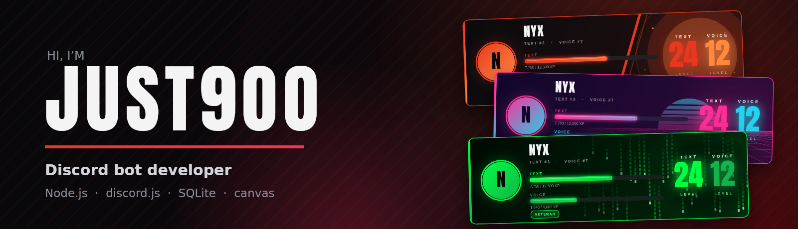

 

---

## About

I build **Discord bots** that run on your own server and are configured from inside Discord. Right now that's a levelling bot and a ticket bot, both designed to look good doing it.

- 🤖 Bots in **Node.js** with **discord.js v14** and **SQLite**
- 🎨 Custom image rendering for rank cards and level-up cards
- 📱 Much of it written and run from my phone, with Termux
- 🛠️ Focus on setup that works the first time: clear READMEs, sensible defaults and tests

---

## Featured projects

### [900LVLBot](https://github.com/Just9OO/900LVLBot)

**A self-hosted Discord levelling bot with 17 card themes and your own custom colors.**

Text and voice XP · activity roles · live theme gallery · `/config` control panel · one-click deploy

---

### [900TicketBot](https://github.com/Just9OO/900TicketBot)

**A self-hosted ticket bot with multi-topic panels, forms, staff applications and a `/setup` dashboard.**

Claim and transfer · priority · HTML transcripts · 1 to 5 star ratings · ticket log

---

## Projects

| Project | What it does | Stack |
|---|---|---|
| [**900LVLBot**](https://github.com/Just9OO/900LVLBot) | Text and voice levelling with rank cards, 17 themes, custom themes and a full in-Discord control panel | `discord.js` `SQLite` `canvas` |
| [**900TicketBot**](https://github.com/Just9OO/900TicketBot) | Ticket panels with forms, staff applications, claim and priority, transcripts, ratings and a `/setup` dashboard | `discord.js` `SQLite` |

---

## Stack

---

## GitHub stats

---

Built with Node.js, caffeine and a phone.

